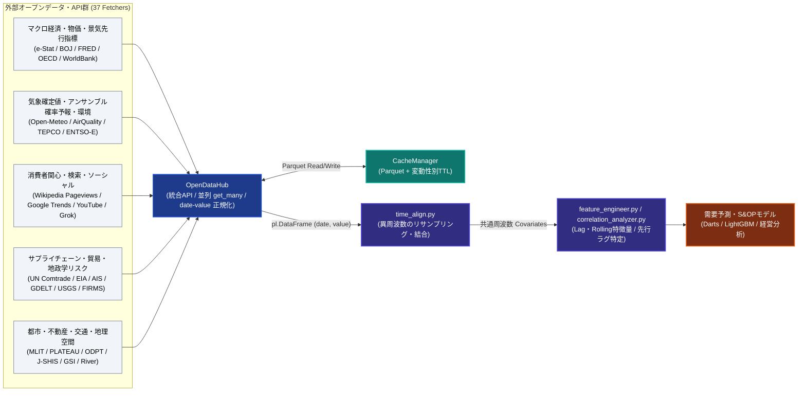

# 🌏 OpenData Skill (v2.4.0)

**世の中に散在するオープンデータ・外部APIを、単一のクリーンなインターフェース（`OpenDataHub`）に統合するデータ取得・特徴量パイプライン・ツールキットです。**

需要予測（[darts-forecast-skill](https://github.com/iida-masashi) 等）や S&OP（Sales & Operations Planning）、ビジネス・経済分析に、市況・天候（確定値およびアンサンブル確率予報）・消費者検索行動・マクロ先行指標・地政学リスクといった「外部要因（外生変数 / Covariates）」を安定的に供給します。SCM（サプライチェーンマネジメント）、小売・マーケティング、製造業、金融・経済分析の各領域を対象に、**37種類のフェッチャー（45以上のデータソース・統計プリセット）**を一つのインターフェースでカバーし、個別のAPI仕様を都度調査・実装する工数を削減します。

---

## 🏗️ アーキテクチャ概要

`OpenDataHub` を中心に、自動フェッチャー検出、スレッドセーフな Parquet キャッシュ、Fail-Loud リトライ層、異周波数の時系列アラインメント（`time_align.py`）、ラグ・移動平均等の特徴量生成（`feature_engineer.py`）、先行ラグ相関分析（`correlation_analyzer.py`）が一貫した Polars パイプラインとして連携します。



---

## 💡 ご提供価値と設計原則

オープンデータ・外部APIの活用には、本来「データソースごとの仕様調査」「認証方式の違いへの対応」「取得失敗時のエラーハンドリング」「異なる周波数（日次・週次・月次・四半期・年次）のデータを結合可能な形へ整える前処理」といった、分析の本質とは直接関係のない付随作業が数多く発生します。本ツールキットは、これらの付随作業を一括して引き受けます。

- **統合インターフェース (`OpenDataHub`)**: 37個のフェッチャーすべてを `OpenDataHub` のメソッド経由で統一的に呼び出し可能。また全スクリプトは単体の CLI ツールとしても実行できます。
- **高い信頼性（Fail Loud, Not Silent 設計）**:
  - 一時的なエラー（HTTP 429/5xx・接続断・タイムアウト）のみを `tenacity` で自動リトライし、プログラムエラーや HTTP 4xx（429除く）、HTTP 200 で返るエラー応答は即座に例外として表面化させます。
  - 空の DataFrame が返るのは提供元が正常に「0件」と応答した場合に限定し、取得失敗を「データ無し」と誤認させない設計とすることで、欠損した外生変数が予測モデルにサイレントに混入する事態を防ぎます。
- **Polars 2.x ネイティブの高速処理**: 内部処理には `Polars`（`>=2.1.0`）を採用。World Bank や OECD 等の多様な日付・横持ちフォーマットも `OpenDataHub._normalize_df()` と `time_align.parse_dates()` により標準の `(date, value)` 契約へ自動変換します。
- **需要予測に直結する確率予報・先行指標（v2.4 新機能）**:
  - **Open-Meteo アンサンブル気象予報 (`get_weather_ensemble`)**: 複数アンサンブルメンバーから気温・降水量の **P10 / P50 / P90 分位点・平均・標準偏差** を算出し、安全在庫計算や確率的需要予測（Quantile Forecast）の不確実性入力としてそのまま利用可能。
  - **Wikimedia Pageviews (`get_wikipedia_views`)**: APIキー不要・日次粒度・レート制限が緩やかで、Google Trends の代替・補完として季節性疾患・イベント・商品の消費者関心度を再現性高く取得可能。
  - **国内 S&OP・需要予測向け e-Stat / 日銀プリセット**: 商業動態統計（小売業販売額）、鉱工業生産指数（IIP）、新設住宅着工戸数、景気ウォッチャー調査、家計調査、毎月勤労統計、企業物価指数（CGPI）・サービス価格指数（SPPI）をワンライナーで取得可能。

---

## 🚀 セットアップ

Python 3.12 以上と [uv](https://docs.astral.sh/uv/) が必要です。

```powershell
# 依存パッケージの同期（Polars 2.1+, Pandas 3.1+, Pytest 9.2+, Ruff 0.17+）
uv sync

# APIキーが必要なソースを使う場合（半数以上のソースはキー不要で利用可能）
Copy-Item env.example .env
# .env を編集し、利用予定のソースに対応するキーのみ設定してください
```

APIキーが未設定のまま該当ソースを呼び出した場合、「どのサイトで、どのように取得すべきか」を案内するメッセージ付きで `MissingApiKeyError` が送出されます（CLI ではメッセージを表示して終了コード1で終了）。

---

## ⚡ クイックスタート & 需要予測パイプライン例

### 1. 基本的なデータ取得（Python API）

```python
from scripts.opendata_hub import MissingApiKeyError, OpenDataHub

hub = OpenDataHub()

# 1) 気象（確定値・予報）＆アンサンブル確率予報（P10/P50/P90・標準偏差）［キー不要］
df_weather  = hub.get_weather(lat=35.6812, lon=139.7671)
df_ensemble = hub.get_weather_ensemble(
    lat=35.6812, lon=139.7671,
    model="icon_seamless",
    daily_vars="temperature_2m_mean,precipitation_sum",
    forecast_days=14,
)

# 2) 消費者関心トレンド：Wikipedia 日次ページビュー［キー不要］
df_wiki = hub.get_wikipedia_views(
    articles=["インフルエンザ", "花粉症"],
    lang="ja",
    start_date="2025-01-01",
    end_date="2025-03-31",
)

# 3) 日銀統計：短観業況判断DI・企業物価指数 (CGPI)［キー不要］
df_tankan = hub.get_boj_tankan(series="tankan_large_mfg")
df_cgpi   = hub.get_cgpi(series="cgpi_all", start_date="202001")

# 4) マクロ経済（World Bank / OECD）［キー不要・自動で (date, value) 縦持ちに正規化］
df_gdp = hub.get_economic(indicators=["gdp"], countries=["JPN", "USA"])
```

### 2. End-to-End 需要予測・外生変数パイプライン（並列取得 ➔ 周波数統合 ➔ ラグ特徴量生成）

異なる周波数（日次・週次・月次・四半期）の外部要因を並列取得し、月次グリッドに整列した上でラグ特徴量・移動平均を生成する一連のパイプライン例です。

```python
from scripts.opendata_hub import OpenDataHub
from scripts.time_align import align_many
from scripts.feature_engineer import engineer_features

hub = OpenDataHub()

# Step 1: 複数ソースをスレッド並列で一括取得
sources = hub.get_many([
    {"label": "weather", "method": "get_weather",         "kwargs": {"lat": 35.68, "lon": 139.77}},
    {"label": "usdjpy",  "method": "get_yahoo",           "kwargs": {"symbol": "USDJPY=X", "period": "2y"}},
    {"label": "cgpi",    "method": "get_cgpi",            "kwargs": {"series": "cgpi_all", "start_date": "202301"}},
    {"label": "tankan",  "method": "get_boj_tankan",      "kwargs": {"series": "tankan_large_mfg", "start_date": "202301"}},
    {"label": "wiki",    "method": "get_wikipedia_views", "kwargs": {"articles": "エアコン", "lang": "ja", "start_date": "2023-01-01", "end_date": "2024-12-31"}},
])

# 取得失敗したソースがないか確認（Fail-Loud 監査）
if hub.last_errors:
    print("取得失敗ソース:", hub.last_errors)

# Step 2: 異なる周波数（日次・月次・四半期）を月次 ('1mo') にリサンプリング＆横結合
covariates_monthly = align_many(
    sources,
    freq="1mo",
    agg={"weather": "mean", "usdjpy": "mean", "cgpi": "last", "tankan": "last", "wiki": "sum"},
)

# Step 3: 予測モデル投入用のラグ変数（1, 3, 6ヶ月前）・移動平均（3, 6ヶ月）・カレンダー特徴量を生成
features_df = engineer_features(
    df=covariates_monthly,
    target_col="wiki",
    date_col="date",
    lags=[1, 3, 6],
    windows=[3, 6],
)
print(features_df.tail(5))
```

### 3. CLI からの直接実行

すべてのスクリプトは単体 CLI として実行可能です。

```powershell
# Yahoo Finance（株価・為替・コモディティ）
uv run python scripts/yahoo_fetcher.py --tickers 7203.T USDJPY=X --start 2024-01-01

# Open-Meteo（確定気象データ / アンサンブル確率予報）
uv run python scripts/meteo_fetcher.py --lat 35.6895 --lon 139.6917 --historical --start 2024-01-01 --end 2024-01-31
uv run python scripts/meteo_fetcher.py --lat 35.6895 --lon 139.6917 --ensemble --ensemble-model icon_seamless --forecast-days 14

# Wikipedia Pageviews（消費者関心トレンド・日次）
uv run python scripts/wikipedia_fetcher.py --articles "インフルエンザ,花粉症" --lang ja --start 2025-01-01 --end 2025-03-31

# 日銀時系列統計（短観DI / 企業物価指数 CGPI / 企業向けサービス価格指数 SPPI）
uv run python scripts/boj_fetcher.py --series cgpi_all --start 202001

# e-Stat 需要予測向けプリセット一覧表示・取得
uv run python scripts/estat_fetcher.py --list-presets
uv run python scripts/estat_fetcher.py --preset retail_sales --limit 5000

# 産業・ユースケース別の推奨データソース検索
uv run python scripts/data_suggester.py "Retail"
```

---

## 📊 全データソース・APIキー・キャッシュTTL・粒度マトリクス

全37フェッチャーおよび主要プリセットの一覧です。詳細な引数仕様は [`references/capabilities.md`](references/capabilities.md)、産業別の活用ガイドは [`references/INDUSTRY_GUIDE.md`](references/INDUSTRY_GUIDE.md) を参照してください。

### 1. 📈 マクロ経済・金融・物価

| データソース | スクリプト | Hub メソッド | APIキー (環境変数) | 既定TTL | 時間粒度 | 主な取得データ・需要予測での用途 |
| :--- | :--- | :--- | :--- | :--- | :--- | :--- |
| **e-Stat（政府統計）** | `estat_fetcher.py` | `get_estat()` | 要 (`ESTAT_API_KEY`) | 24h | 月次/四半期/年次 | 国勢調査・CPI・労働力調査（10万件超 `NEXT_KEY` 自動ページング・10桁時間コード正規化対応） |
| **e-Stat 需要予測プリセット** | `estat_fetcher.py` | `get_retail_sales()` / `get_industrial_production()` / `get_housing_starts()` / `get_economy_watchers()` / `get_household_spending()` / `get_monthly_wages()` | 要 (`ESTAT_API_KEY`) | 7d | 月次 | **【v2.4追加】** 商業動態統計、鉱工業生産指数(IIP)、新設住宅着工、景気ウォッチャー、家計調査、毎月勤労統計 |
| **日銀時系列統計（短観・物価・マネー）** | `boj_fetcher.py` | `get_boj_tankan()` / `get_cgpi()` / `get_boj()` | **不要** | 7d | 月次/四半期 | **【v2.4拡充】** 短観業況判断DI（製造/非製造、実績/先行き）、企業物価指数（CGPI国内/輸出/輸入）、サービス価格指数（SPPI）、マネーストックM2 |
| **内閣府 景気動向指数** | `estat_fetcher.py` | `get_keiki_di()` | 要 (`ESTAT_API_KEY`) | 7d | 月次 | CI/DI（先行・一致・遅行指数）。景気転換点の捕捉 |
| **JNTO 訪日外客数** | `estat_fetcher.py` | `get_inbound_visitors()` | 要 (`ESTAT_API_KEY`) | 7d | 月次 | 国籍・地域別の入国外国人数（港次元を自動集約） |
| **Yahoo Finance** | `yahoo_fetcher.py` | `get_yahoo()` | **不要** | 12h | 日次 | 株価（日米欧）・為替（FX）・コモディティ先物（原油・銅・穀物）・ETFフォールバック |
| **ECB / BOJ 公的為替** | `official_fx_fetcher.py` | `get_official_fx()` | **不要** | 12h | 日次/月次 | ECB Eurosystem公式レート・日銀公的為替レート（会計・税務・契約用） |
| **FRED（米連銀・信用スプレッド）** | `fred_fetcher.py` | `get_fred()` / `get_credit_spread()` | 要 (`FRED_API_KEY`) | 24h | 日次/週次/月次 | **【v2.4拡充】** 米国政策金利、CPI、失業率に加え、ハイイールド債・投資適格債スプレッド (`hy_spread`, `ig_spread`)、長短金利差 (`yield_curve_10y2y`)、実質金利 (`real_rate_10y`)、VIX、金融ストレス指数 (`stl_fsi`) プリセット |
| **World Bank** | `worldbank_fetcher.py` | `get_economic()` | **不要** | 30d | 年次 | 各国GDP、インフレ率、人口、貿易収支（Hubで `YR2023` 横持ちを `date`/`value` 縦持ちへ自動正規化） |
| **OECD** | `oecd_fetcher.py` | `get_oecd()` | **不要** | 30d | 月次/四半期/年次 | 先進国の主要経済指標（MEI）、CLI、労働市場統計 |
| **EDINET DB** | `edinet_fetcher.py` | `get_edinet_financials()` | 要 (`EDINET_API_KEY`) | 24h | 年次/四半期 | 上場企業の有価証券報告書財務データ（売上・営業利益・ROE/ROA等） |

### 2. 🌤️ 気象・アンサンブル確率予報・環境・エネルギー

| データソース | スクリプト | Hub メソッド | APIキー (環境変数) | 既定TTL | 時間粒度 | 主な取得データ・需要予測での用途 |
| :--- | :--- | :--- | :--- | :--- | :--- | :--- |
| **Open-Meteo（気象確定値・予報）** | `meteo_fetcher.py` | `get_weather()` | **不要** | 3h | 1時間/日次 | 過去気象アーカイブ（ERA5）および16日予報（気温・降水量・風速・日射量） |
| **Open-Meteo アンサンブル予報** | `meteo_fetcher.py` | `get_weather_ensemble()` | **不要** | 3h | 1時間/日次 | **【v2.4追加】** ICON/GFS/ECMWF等のアンサンブルメンバーから **P10/P50/P90・平均・標準偏差** を算出（確率的需要予測・安全在庫用） |
| **Open-Meteo 大気質** | `air_quality_fetcher.py` | `get_air_quality()` | **不要** | 3h | 1時間 | PM2.5、PM10、NO2、オゾン濃度（ヘルスケア・外出需要の予測） |
| **TEPCO でんき予報** | `power_fetcher.py` | `get_power()` | **不要** | 3h | 1時間/5分 | 東京電力管内の電力使用実績・予測・供給力・使用率 |
| **ENTSO-E（欧州電力）** | `entsoe_fetcher.py` | `get_eu_power()` | 要 (`ENTSOE_API_KEY`) | 6h | 15分/1時間 | 欧州15カ国の電力需給実績・予測、Day-Ahead価格、電源別発電量（A75揚水消費除外・A03前方補完対応） |
| **EIA（米エネルギー情報局）** | `eia_fetcher.py` | `get_energy_eia()` | 要 (`EIA_API_KEY`) | 24h | 週次/月次 | 米原油・ガソリン・天然ガス在庫、精製所稼働率 |

### 3. 📢 消費者トレンド・ソーシャル・カレンダー

| データソース | スクリプト | Hub メソッド | APIキー (環境変数) | 既定TTL | 時間粒度 | 主な取得データ・需要予測での用途 |
| :--- | :--- | :--- | :--- | :--- | :--- | :--- |
| **Wikimedia Pageviews** | `wikipedia_fetcher.py` | `get_wikipedia_views()` | **不要** | 12h | 日次/月次 | **【v2.4追加】** Wikipedia記事の日次閲覧数（多言語・複数記事一括対応）。季節商品・感染症・イベント関心の高再現性指標 |
| **Google Trends** | `trends_fetcher.py` | `get_trends()` | **不要** | 12h | 日次/週次 | 検索キーワードの相対的関心度（0〜100、`trendspyg` 経由・1〜5語同時比較） |
| **YouTube Data API v3** | `youtube_fetcher.py` | `get_youtube()` | 要 (`YOUTUBE_API_KEY`) | 12h | 投稿単位 | 動画コメント・高評価数・エンゲージメント抽出 |
| **xAI Grok (`x_search`)** | `x_grok_fetcher.py` | `get_x_grok()` | 要 (`XAI_API_KEY`) | 1h | 投稿単位 | X（旧Twitter）直近30日のリアルタイム投稿検索・センチメント分析 |
| **日本の祝日 (Nager/内閣府)** | `holiday_fetcher.py` | `get_holiday()` | **不要** | 30d | 日次 | 日本の国民の祝日一覧（カレンダー特徴量用） |
| **カレンダー・商業イベント** | `events_fetcher.py` | `get_events()` | 任意 (`CONNPASS_API_KEY`) | 24h | 日次 | 商業イベント（バレンタイン・ブラックフライデー等）・祝日・Connpassイベント |

### 4. 🎯 先行指標・サプライチェーン・貿易・業界特化・災害リスク

| データソース | スクリプト | Hub メソッド | APIキー (環境変数) | 既定TTL | 時間粒度 | 主な取得データ・需要予測での用途 |
| :--- | :--- | :--- | :--- | :--- | :--- | :--- |
| **PMI / 製造業受注 / CLI** | `pmi_fetcher.py` | `get_pmi()` | 要 (`FRED_API_KEY`) | 24h | 月次 | 米製造業新規受注、日米中欧 OECD 景気先行指数（CLI）、政策不確実性指数 |
| **半導体 Book-to-Bill** | `semicon_fetcher.py` | `get_semicon()` | 要 (`FRED_API_KEY`) | 7d | 月次 | 米コンピュータ・電子製品製造業の出荷・新規受注・在庫および Book-to-Bill 比 |
| **UN Comtrade（国際貿易）** | `comtrade_fetcher.py` | `get_comtrade()` | 要 (`COMTRADE_API_KEY`) | 7d | 月次/年次 | HSコード粒度の二国間輸出入貿易フロー（金額・数量・重量） |
| **海運市況・公的運賃指数** | `freight_fetcher.py` | `get_freight()` / `get_freight_index()` | ETF不要 / 指数要 (`FRED_API_KEY`) | 24h / 7d | 日次/月次 | **【v2.4拡充】** 日次海運ETF・船社プリセット（`BDRY`, `BWET`, `jp_liners`）＋ FRED公的運賃PPI（外航深海海運 `deep_sea_freight_ppi`、航空 `air_freight_ppi`、トラック `trucking_freight_ppi`）および Cass 物流指数 |
| **AIS 港湾混雑** | `ais_fetcher.py` | `get_port_congestion()` | 要 (`DATALASTIC_API_KEY` / `AISHUB_USERNAME`) | 1h | スナップショット | 世界主要15港湾（上海・シンガポール・LA・ロッテルダム等）の停泊・航行船舶数と平均船速 |
| **GDELT（地政学リスク）** | `gdelt_fetcher.py` | `get_gdelt()` | **不要** | 2h | 15分/日次 | スエズ・紅海・台湾海峡等のサプライチェーン断絶ニュース量・感情トーン |
| **USDA / FAOSTAT（農業・食料）** | `usda_fetcher.py` | `get_agri()` | FAO不要 / USDA要 (`USDA_API_KEY`) | 7d | 年次 | グローバル作況・生産量・面積（FAOSTAT）および米国農務省 QuickStats |
| **USGS Earthquake（世界地震）** | `usgs_fetcher.py` | `get_earthquakes()` | **不要** | 1h | イベント単位 | グローバル地震発生データ（マグニチュード・震源・深さ・津波フラグ） |
| **NASA FIRMS（山火事）** | `firms_fetcher.py` | `get_wildfires()` | 要 (`FIRMS_MAP_KEY`) | 3h | イベント単位 | 衛星観測（VIIRS/MODIS）による世界の山火事ホットスポット・放射熱出力 |

### 5. 🏙️ 地域・都市・交通・ユーティリティ

| データソース | スクリプト | Hub メソッド | APIキー (環境変数) | 既定TTL | 時間粒度 | 主な取得データ・需要予測での用途 |
| :--- | :--- | :--- | :--- | :--- | :--- | :--- |
| **MLIT 不動産情報ライブラリ** | `mlit_fetcher.py` | `get_mlit()` | 要 (`MLIT_API_KEY`) | 30d | 四半期/年次 | 不動産取引価格情報・地価公示データ |
| **PLATEAU（3D都市モデル）** | `plateau_fetcher.py` | `get_plateau()` | **不要** | 30d | メタデータ | 国交省 Project PLATEAU の全国の 3D 都市モデルカタログ |
| **ODPT（公共交通）** | `odpt_fetcher.py` | `get_odpt()` | 要 (`ODPT_API_KEY`) | 5m | リアルタイム | 鉄道・バス等の運行情報・時刻表・駅乗降客数データ |
| **国交省 川の防災情報** | `river_fetcher.py` | `get_river()` | **不要** | 10m | 10分/1時間 | 河川水位・流量リアルタイム観測値 |
| **J-SHIS（地震ハザード）** | `jshis_fetcher.py` | `get_jshis()` | **不要** | 30d | 地点メッシュ | 緯度経度に対する今後30年の震度別地震発生確率・表層地盤増幅率 |
| **国土地理院 ジオコーディング** | `gsi_fetcher.py` | `get_gsi()` | **不要** | 30d | 静的 | 住所・地名から緯度経度（座標）への変換 |
| **ZipCloud（郵便番号）** | `zipcode_fetcher.py` | `get_zipcode()` | **不要** | 30d | 静的 | 郵便番号から都道府県・市区町村・町域への変換 |
| **国税庁 法人番号公表API** | `corp_fetcher.py` | `get_corp()` | 要 (`NTA_APP_ID`) | 30d | 静的 | 法人名・所在地からの法人番号（13桁）および基本情報の照会 |
| **e-Gov / CKAN カタログ** | `ckan_fetcher.py` | `get_ckan()` | **不要** | 7d | メタデータ | data.go.jp 等の CKAN 互換データカタログ横断検索 |

---

## 🧪 テストと品質管理

課題・バグ・機能拡張はすべて [GitHub Issues](https://github.com/iida-masashi/opendata-skill/issues) で一元管理しています。

```powershell
# 全ユニットテスト実行（390テスト、ネットワーク完全遮断・モック検証）
uv run pytest -q --tb=short

# 実APIにアクセスする統合テスト（設定済みのAPIキーおよびキー不要APIを実通信で検証）
uv run pytest -m integration -q

# Ruff による静的解析・フォーマット検証
uv run ruff check scripts/ tests/
```

---

## 📚 ドキュメント一覧

| ファイル | 内容 |
|---|---|
| [`SKILL.md`](SKILL.md) | AIエージェント向けのスキル定義（エントリポイント） |
| [`CLAUDE.md`](CLAUDE.md) | 開発者・AIコーディングエージェント向けの設計規律・アーキテクチャ仕様 |
| [`references/capabilities.md`](references/capabilities.md) | 取得可能データの詳細カタログ |
| [`references/usage_guide.md`](references/usage_guide.md) | CLI / `OpenDataHub` / 時系列アラインメントの詳細ガイド |
| [`references/INDUSTRY_GUIDE.md`](references/INDUSTRY_GUIDE.md) | 産業・ユースケース別の推奨データソースマッピング |
| [`docs/REQUIREMENTS.md`](docs/REQUIREMENTS.md) | 機能・非機能要件定義 |
| [`docs/DATA_SOURCE_TERMS.md`](docs/DATA_SOURCE_TERMS.md) | **各データソースの利用規約・出典表記ガイド（必読）** |

---

## ⚠️ 外部データサービスのご利用にあたって

本ソフトウェア自体は MIT ライセンスにて提供しておりますが、**取得したデータそのものの利用条件は、各データ提供元の規約に従うものとします**。ご利用にあたっては、特に以下の点にご留意ください。

- **e-Stat / FRED / Open-Meteo / Wikimedia** には、規約上の**出典表記要件**や User-Agent ポリシーが定められています。
- **Open-Meteo** の無償APIは、**非商用利用限定**とされています（商用利用時は商用プラン契約が必要）。
- **yfinance / trendspyg** は非公式ライブラリであり、Yahoo! / Google の規約上グレーな位置づけとなります（研究・個人利用の範囲での利用を推奨いたします。業務での検索関心度取得には公式APIである `wikipedia_fetcher.py` の併用・代替を推奨します）。
- **ODPT** のご利用には、開発者登録および規約への同意が必須です。

商用利用をご検討の際は、各データ提供元の一次情報を必ず再確認いただくとともに、詳細は [`docs/DATA_SOURCE_TERMS.md`](docs/DATA_SOURCE_TERMS.md) を必ずご確認ください。

## ライセンス

[MIT License](LICENSE)
